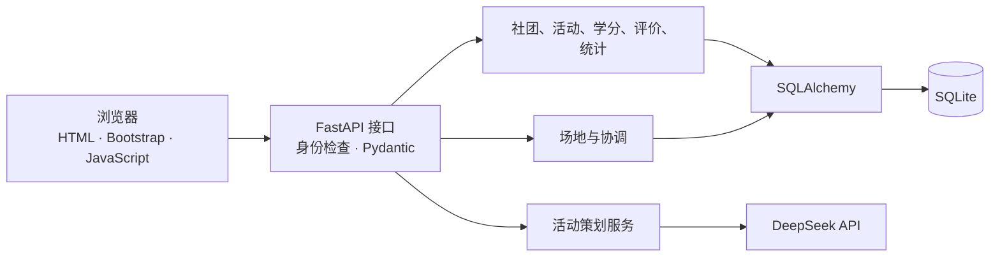
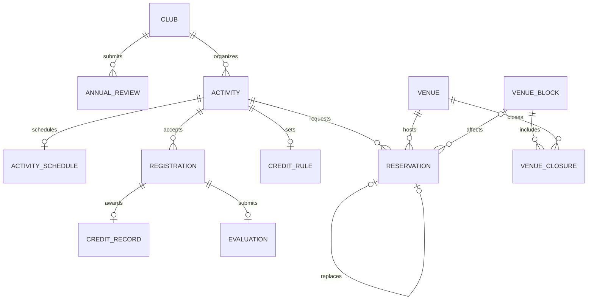
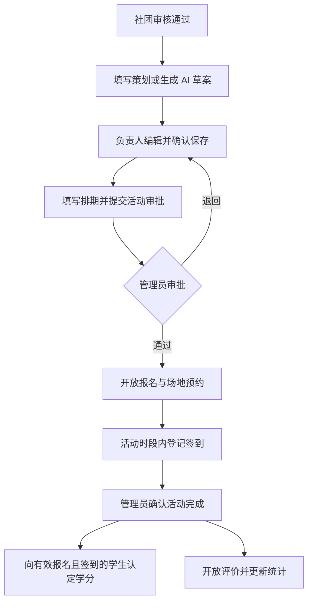

# 高校社团活动全流程管理系统设计报告

需求基线 v1.0 · 提交前草稿

## 1. 架构

系统以 FastAPI 单体运行。HTML、Bootstrap 和 JavaScript 通过 JSON 接口读取和提交数据。Pydantic 校验请求和 AI 返回，SQLAlchemy 管理 SQLite。令牌在服务器端环境配置，接口按账号验证权限。

| 目录 | 实现 |
|---|---|
| `app/routers` | 社团与年审、活动状态及报名、场地和征用、学分评价与数据库统计 |
| `app/services` | 场地准入、可用性检查及批量建议接口 |
| `app/ai.py`、`app/prompts` | DeepSeek 请求、独立提示词、结构化响应校验 |
| `app/models.py`、`app/database.py` | 表结构、会话及事务 |
| `app/index.html`、`app/static` | 各角色的交互页面，Bootstrap 样式随项目分发 |

## 2. 数据设计

| 数据 | 约束与设计理由 |
|---|---|
| 社团、年审 | 社团保存负责人账号，每社团每年最多一份年审 |
| 活动、活动排期 | 活动草稿与排期分表，兼容第一批数据库已有的草稿。审批后排期保持固定 |
| 报名、签到 | 报名以活动编号和学生账号为联合主键。取消可恢复，签到时间写在有效报名记录上 |
| 场地、预约、征用 | 支持同一次征用覆盖多个场地。每场活动最多一条待审核、已确认或待协调的预约。换场保留原预约和替换关系 |
| 学分、评价 | 记录关联活动报名。每活动每学生最多一条学分和一条评价。学分以百分之一分存储，统计前按整数累计 |

原型保留学生及管理员的演示身份。附加学生账号用于演示跨社团权限和互不相同的报名记录。系统把日期统一转为 UTC 存储，并向页面返回时区信息。

## 3. 活动生命周期

活动结束操作与学分插入置于同一事务。活动完成后重试返回已有认定人数，评价和统计读实际业务记录。管理员可在完成前为活动修改学分规则，缺省值为 1 分。签到仅在活动时段内开放，活动开始后关闭报名和取消报名。

## 4. 场地预约与协调

场地预约采用左闭右开时间区间，重叠条件为 `A.start < B.end && B.start < A.end`。申请和审核都校验容量、设备、有效预约和征用。待审申请先占位，拒绝后释放占用。涉及冲突判断的写操作先进入 SQLite 写事务，再读取候选或预约并写入，避免并发请求同时占用同一场地。

征用登记后，原预约标记为受影响。系统按每笔预约的原定时间和活动需求筛出候选。管理员可从候选中人工选择。确认时在事务中重查，任何一条冲突会回滚整批变更。

批量匹配按活动优先级和预约编号生成固定搜索顺序，再用深度优先搜索尝试各个候选场地和暂不安排两类选择。算法通过剩余活动数和各场地可容纳的不重叠时段数估计上界，跳过无法改善结果的分支。比较方案时先看成功安置数量，再比较完整的活动安置顺序，最后比较场地编号。最坏情况下搜索规模随活动数指数增长，适合课程原型的小批量征用场景。

页面预填系统建议，管理员可调整后确认。接口验收验证了两场活动竞争同一场地时，系统把只能使用该场地的活动留在那里，将另一场安排到备用场地，并保持两场活动原定时段。

## 5. DeepSeek 与错误处理

浏览器把活动构想交给后端。后端确认社团归属，带独立提示词调用 DeepSeek，并用 Pydantic 验证返回结构。浏览器将结果放入可编辑表单，独立保存请求须含人工确认。SQLite 活动状态和场地状态由业务接口管理。真实调用记录可在验收记录中查阅，API 密钥通过环境变量配置。

请求错误由接口返回可读反馈。模拟用例覆盖 DeepSeek 504 超时和 502 无效响应。并发预约、报名上限、重复签到和重复学分认定由隔离数据库验证。具体用例见[验收记录](acceptance.md)。

## 6. 演示账号与数据

运行 `python -m app.demo`，打开 `http://127.0.0.1:8765/`，在页面顶部用以下令牌登录。令牌只供本地演示服务使用。

| 令牌 | 账号及操作 |
|---|---|
| `demo-admin` | 管理员，审批、签到、场地征用及统计 |
| `demo-student` | 编程社负责人兼学生，提交预约和查询个人学分 |
| `demo-network` | 网络技术社负责人兼学生，演示独立社团和跨账号权限 |

SQLite 演示数据包含 20 个社团、120 场活动、40 个场地、50 条有效报名及一条已签到对应的学分记录。活动覆盖实践、竞赛、工作坊、讲座、交流及展演。数据由业务接口写入。

40 个场地包括 12 间普通教室、6 间实验教室、6 个舞台、6 间报告厅、6 间会议室和 4 间用于冲突协调的设备教室。展演有舞台预约，专题报告有报告厅预约。场地列表显示容量和配备设备。

选题参考 [Kaggle Meta Kaggle Hackathon](https://www.kaggle.com/competitions/meta-kaggle-hackathon/data) 和 [GitHub Hack-HQ 活动目录](https://github.com/Hack-HQ/hackhq)，对应样例为校园数据分析挑战、校园游戏创作接力、校园开放数据实践和校园数据可视化工坊。这里只采用公开活动主题，校内社团、排期、场地、名额、报名、签到及学分均为模拟记录。TechEventsNearMe 的许可限制提取与重新分发数据，因此未导入该数据集。

## 附录 TRAE 开发记录

两张证据原图随本地报告保留。

图 A-1 记录在 TRAE 提交的开发任务、涉及的代码文件和算法说明。界面显示实际选用的模型为 DeepSeek-V4.1-Flash Max。

图 A-2 记录 TRAE 当时汇报的测试结果，包括 7 项专项测试通过和 10 项常规测试通过。后续复核补充了活动同等优先级时的排序用例，修正后专项测试共 8 项通过。系统运行时的 DeepSeek API 响应另见[验收记录](acceptance.md)。

